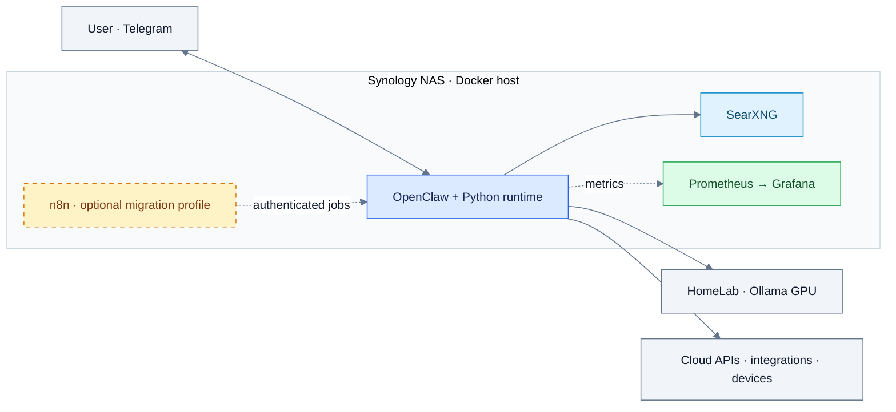

# Tenazas

A personal assistant built on OpenClaw, combining a Python runtime, Telegram,
homelab automation, job search, personal finance, and smart home controls.
Tenazas runs on a Synology NAS and uses a separate Ollama GPU host for local inference.

Documentation reviewed against repository code on **2026-10-28**. Deployment
status, active schedules, installed models, and service availability require host verification.

## Documentation

| Start here | Purpose |
|---|---|
| [Documentation index](docs/README.md) | All maintained guides and historical references |
| [Setup](docs/setup.md) | Configuration, mounts, permissions, and startup |
| [Architecture](docs/architecture.md) | Deployment map, request flow, and operational boundaries |
| [Development](docs/development.md) | Python environment, checks, and contribution workflow |
| [Infrastructure](INFRA.md) | Services, ports, exporters, and external dependencies |
| [Models](MODELS.md) | Model selectors, roles, and fallback configuration |

## System overview



Solid arrows show functional dependencies; dotted arrows show telemetry or optional
scheduling. See the [detailed architecture](docs/architecture.md) for process,
network, request, and persistence boundaries.

## Capabilities

| Area | Implementation |
|---|---|
| Telegram | Deterministic interceptors, conversation context, approval callbacks, watchdog |
| Orchestration | Existing orchestrator plus an optional domain-agent coordinator |
| Domain agents | Infrastructure, finance, research, security, job search, and other domains |
| Inference | Role-based routing, backend detection, VRAM limits, and guardrails |
| Monitoring | Five isolated workers with individual timeouts |
| Knowledge | Retrieval, shared memory, and memory consolidation modules |
| Automation | DSM wrappers and an authenticated HTTP runner; optional n8n scheduling |
| Observability | Runtime exporters, Prometheus rules, and provisioned Grafana dashboards |
| Job search | Discovery, matching, application tracking, and tailored CV preparation |

## Getting started

[Compose](docker-compose.yml) defines `openclaw`, `prometheus`, `grafana`, and
`searxng`. The `n8n` service requires the `migration` profile. Ollama, ChromaDB,
Piper, and the media stack are external to this Compose deployment.

```bash
git clone https://github.com/sebastianbasadre/tenazas.git
cd tenazas
cp .env.example .env
```

Complete credentials, gateway configuration, permissions, and mounted files using
[Setup](docs/setup.md) before starting services. `openclaw.example.json` illustrates
Tenazas helper settings; it needs adaptation to the gateway schema and is not a
complete deployment configuration.

```bash
# After completing setup:
docker compose config --quiet
docker compose up -d --build
docker compose ps
```

## Validation

Python requires **3.11+**. The container uses Node.js 24 and a pinned OpenClaw
build argument.

```bash
python -m pip install -r requirements-dev.txt
python -m pytest --collect-only
# Curated Linux/container runner:
bash tests/run_tests.sh
```

Some suites require Linux paths, Docker, external APIs, or devices. Follow
[Development](docs/development.md) to select suitable checks. Test counts and model
evaluation scores should come from each run rather than a fixed documentation total.

## Operational boundaries

- Docker socket access is privileged; the runtime includes action validation and auditing.
- `docker_wrapper.py` allows reads and `restart/start/stop`, protecting `openclaw`
  and `watchtower` from its mutating actions.
- The job runner requires an operator token and defaults to `127.0.0.1:18891`.
- Accepted proposals may be applied by `proposal_executor.py` through sandbox
  branches, validation, limits, and rollback.
- A failed healthcheck marks the container `unhealthy`; it does not itself restart it.
  The `unless-stopped` policy handles process exits.
- Keep credentials, tokens, and personal runtime data out of commits.

See [n8n cutover](docs/n8n-cutover-runbook.md),
[job search](docs/job-search-platform.md), and
[workspace context](workspace/TENAZAS-CONTEXT.md).

## License

No license file is included. Public repository visibility does not itself grant
permission to use, modify, or redistribute the project.
