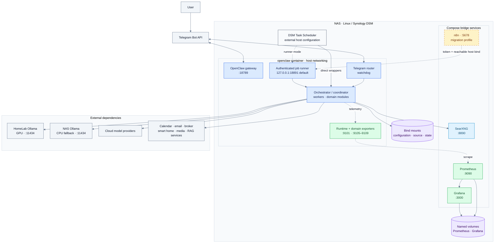
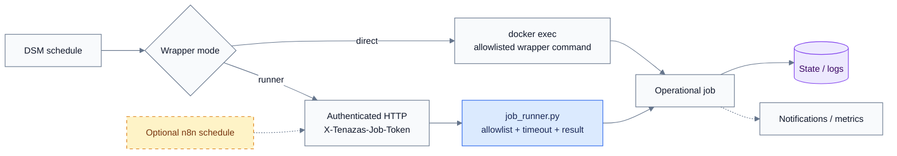

# Architecture

Reviewed against repository code on **2026-10-28**. These diagrams describe
implemented components and configuration boundaries. They do not assert which
flags, workflows, or DSM tasks are enabled on the live NAS.

## Deployment map

The NAS owns the assistant runtime and observability. GPU inference and personal
integrations sit outside the Compose stack. Amber nodes indicate optional scheduling.

Solid arrows represent functional dependencies; dotted arrows represent optional
scheduler paths or telemetry. Ports are host-facing defaults. The map groups
runtime modules for readability rather than showing one service per Python file.

Both gateway and Python Telegram components start in `startup.sh`. Check actual
channel configuration and polling ownership to avoid incompatible consumers.
Ollama, ChromaDB, Piper, and the media stack are not provisioned by this Compose file.

## Request handling

The deterministic path resolves known actions before free-text routing. The
coordinator is a configurable alternative; it does not replace every interceptor.

```mermaid
%%{init: {"theme":"base","themeVariables":{"fontFamily":"Segoe UI, Arial, sans-serif","fontSize":"14px","primaryColor":"#f8fafc","primaryTextColor":"#0f172a","primaryBorderColor":"#64748b","lineColor":"#64748b","secondaryColor":"#f1f5f9","tertiaryColor":"#ffffff","clusterBkg":"#f8fafc","clusterBorder":"#cbd5e1","edgeLabelBackground":"#ffffff"},"flowchart":{"nodeSpacing":30,"rankSpacing":40,"curve":"basis"}}}%%
flowchart LR
    Input["Telegram update"] --> Entry["telegram_router.py<br/>authorization · context · callbacks"]
    Entry --> Known{"Known interceptor
or callback?"}
    Known -->|yes| Handler["Existing handler<br/>skill / approval / domain operation"]
    Known -->|no| Flag{"Coordinator enabled?"}
    Flag -->|false default| Legacy["orchestrator.py<br/>classification + pipelines"]
    Flag -->|true| Coord["agent_coordinator.py<br/>ownership + strategy + aggregation"]
    Coord --> Agents["Domain agents<br/>observations + recommendations"]
    Legacy --> Work["Tools · retrieval · inference<br/>as required by the selected path"]
    Agents --> Work
    Handler --> Result["Response + telemetry"]
    Work --> Result
    Result --> Send["Telegram transport"]
    style Flag fill:#fef3c7,stroke:#d97706,color:#78350f
    style Entry fill:#dbeafe,stroke:#2563eb,color:#172554
    style Coord fill:#dbeafe,stroke:#2563eb,color:#172554
    style Result fill:#dcfce7,stroke:#16a34a,color:#14532d
```

`runtime_config.use_agent_coordinator()` reads `USE_AGENT_COORDINATOR`, then
`channels.telegram.useAgentCoordinator`; the default is `false`. It is a Tenazas
helper setting and must not be assumed valid in every gateway schema.

The coordinator registers `infra`, `personal`, `finance`, `research`, `self_improve`,
`security`, `portfolio_risk`, `subscriptions`, `job_search`, `home_reliability`,
`media_stack`, `daily_brief`, and `runbook`. Ownership evaluation uses threads.
`agent_protocol.py` defines observations and recommendations; conflict handling,
arbitration, correlation IDs, and metrics have separate modules.

## Routing boundaries

| Decision | Source | Output or effect |
|---|---|---|
| Entry routing | `telegram_router.py` | Interceptor or response path |
| Pipeline selection | `orchestrator.py` | Classification and execution |
| Domain ownership | `agent_coordinator.py` | Agent strategy and aggregate result |
| Closed-label tool classification | `tool_tuning/router.py` | `RouteResult` |
| Tool execution | `tool_tuning/router_runtime.py` | Handler output or chat fallback |
| Model/backend selection | `model_router.py` | Role/capability selection with guardrails |
| Gateway rate-limit recovery | `model_failover.py` | Separate gateway model configuration change |

The model router and gateway failover monitor have different responsibilities.
Their settings do not form one universal fallback chain. See [Models](../MODELS.md)
and the [routing contract](../workspace/runtime/INTERFACE_CONTRACT.md).

## Scheduled operations

Use one scheduler per job. The runner exposes nine explicit jobs; n8n uses a
Docker bridge and cannot reach a host-loopback-only listener through
`host.docker.internal`. Configure a reachable bind and host access restrictions
before cutover. See the [runbook](n8n-cutover-runbook.md).

`worker_supervisor.py` runs the following subprocesses sequentially, allowing
later workers to run after an earlier timeout or failure:

| Worker | Timeout |
|---|---:|
| `runtime_worker` | 60 s |
| `diagnostics_worker` | 30 s |
| `rag_worker` | 30 s |
| `agents_worker` | 30 s |
| `learning_worker` | 30 s |

The lock becomes stale after 600 s. A five-minute DSM cadence is a deployment
configuration, not a task automatically installed by Compose.

## Process lifecycle and state

`startup.sh` launches the gateway, metrics, failover monitor, job runner, Telegram
router, job-search watcher, and portfolio/network/finance/evaluation exporters.
The Telegram router and job-search watcher have watchdogs. Reconciliation and IOL
refresh loops are controlled by environment flags.

| Persistence boundary | Contents |
|---|---|
| `state/` → `.openclaw/` | Gateway configuration, credentials, operational workspace, agent state |
| `workspace/runtime/` → `runtime/` | Source plus module-specific generated JSON, logs, and domain artifacts |
| `n8n/data/` | Optional scheduler data |
| Named volumes | Prometheus time series and Grafana state |
| External hosts/services | Models, vector storage, speech data, and other integrations |

Modules also use SQLite and domain-specific files. There is no single database
or uniform state path; inspect each module before migration or backup.

A gateway healthcheck does not cover every background process or restart an
`unhealthy` container. Inspect individual endpoints and logs.

## Action and improvement boundaries

`docker_wrapper.py` validates names and allowed actions, protects selected
containers, and audits calls. `safety_guard.py` adds checks. The mounted Docker
socket remains privileged; a wrapper does not prove all external scripts use it.

`proposal_executor.py` selects `accepted` proposals, distinguishes deterministic
from manual-only work, and uses sandbox branches, validation, limits, and rollback.
Human review must precede acceptance that enables execution. Staging files are
candidates, not evidence of approval or deployment.

## Source of truth

[Compose](../docker-compose.yml), [startup](../startup.sh),
[runtime modules](../workspace/runtime/), [Prometheus](../prometheus.yml),
[setup](setup.md), and [historical planning state](../.planning/STATE.md).
