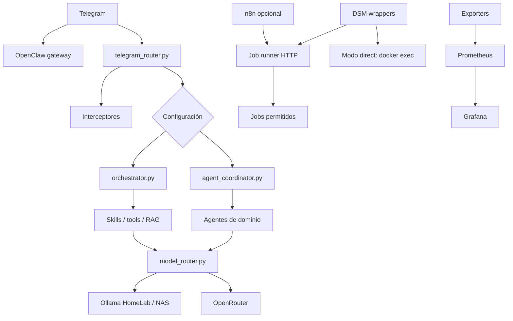

# Arquitectura de Tenazas

Revisión: **2026-10-28**. Describe la implementación del checkout, sin afirmar qué
flags, tareas DSM o workflows están habilitados en producción.

## Servicios

`startup.sh` inicia el gateway y el router Python. La propiedad del polling y la
configuración Telegram deben revisarse en el despliegue para evitar consumidores
simultáneos incompatibles. El diagrama muestra componentes, no garantiza que toda
consulta atraviese todas las capas.

## Entrada y coordinación

`telegram_router.py` combina interceptores deterministas, callbacks/aprobaciones,
contexto y routing. Para texto libre, `runtime_config.use_agent_coordinator()`
consulta `USE_AGENT_COORDINATOR` y luego `channels.telegram.useAgentCoordinator`.
El default es `false`; no equivale a activar toda la lógica de agentes en producción.

El coordinador registra dominios en `AGENT_MODULES`: `infra`, `personal`, `finance`,
`research`, `self_improve`, `security`, `portfolio_risk`, `subscriptions`,
`job_search`, `home_reliability`, `media_stack`, `daily_brief` y `runbook`.
Evalúa ownership con threads, selecciona estrategia, agrega observaciones y
recomendaciones y registra correlación/métricas. Los contratos viven en
`agent_protocol.py`; conflictos y arbitraje tienen módulos propios.

El orquestador conserva clasificación, pipelines y ejecución compatibles con
el camino anterior. Su implementación se apoya en módulos auxiliares; no asumir
que toda la lógica reside en un solo archivo.

## Routing de tools y modelos

Son decisiones distintas:

- `tool_tuning/router.py`: regex y clasificador Ollama; produce un `RouteResult`.
- `tool_tuning/router_runtime.py`: despacha handlers y produce texto o telemetría.
- `routes_contract.py`: labels canónicas y aliases.
- `model_router.py`: roles, catálogo, backends, VRAM, guardrails y fallback.
- `model_failover.py`: monitor separado que cambia el modelo del gateway ante 429.

Ver [contrato de routing](../workspace/runtime/INTERFACE_CONTRACT.md) y
[modelos](../MODELS.md). El monitor del gateway no define la cadena del router Python.

## Procesos y planificación

`startup.sh` levanta gateway, métricas, failover, runner, router Telegram con
watchdog, watcher laboral y exporters de cartera, red, finanzas y evaluación.
El reconciliador y los refrescos IOL dependen de flags de entorno.

`worker_supervisor.py` ejecuta secuencialmente subprocessos aislados:

| Worker | Timeout |
|---|---:|
| `runtime_worker` | 60 s |
| `diagnostics_worker` | 30 s |
| `rag_worker` | 30 s |
| `agents_worker` | 30 s |
| `learning_worker` | 30 s |

Usa lock con detección de antigüedad de 600 s. Se diseña para una tarea DSM cada
cinco minutos; el Compose no instala esa tarea. Revisar el scheduler real antes
de añadir cron para evitar duplicados.

El runner HTTP expone únicamente los nueve jobs de su allowlist. Los wrappers
DSM tienen modos `direct` y `runner`; n8n usa HTTP autenticado y está detrás del
perfil `migration`. Las guías de cutover describen pasos propuestos, no un inventario
verificado de jobs habilitados.

## Persistencia y seguridad

El código runtime se monta aparte del directorio `.openclaw`. Conviven JSON junto
a los módulos, estado bajo `.openclaw/state`, SQLite, logs y archivos de dominio.
Las rutas exactas dependen del módulo; no hay una base de datos única.

`docker_wrapper.py` valida acciones y nombres, protege contenedores y audita.
`safety_guard.py` agrega controles. El socket Docker y los procesos que lo usan
siguen teniendo privilegios del host: la existencia del wrapper no garantiza
que cada script externo pase por él.

`proposal_executor.py` procesa propuestas `accepted`, clasifica ejecutabilidad y
usa sandbox Git, validación, límites y rollback. Los candidatos manuales y los
flujos de aprobación deben revisarse junto con su configuración; no asumir que
ningún cambio puede aplicarse automáticamente tras ser aceptado.

## Fuentes

[Compose](../docker-compose.yml), [startup](../startup.sh),
[runtime](../workspace/runtime/), [Prometheus](../prometheus.yml) y
[planificación histórica](../.planning/STATE.md).
